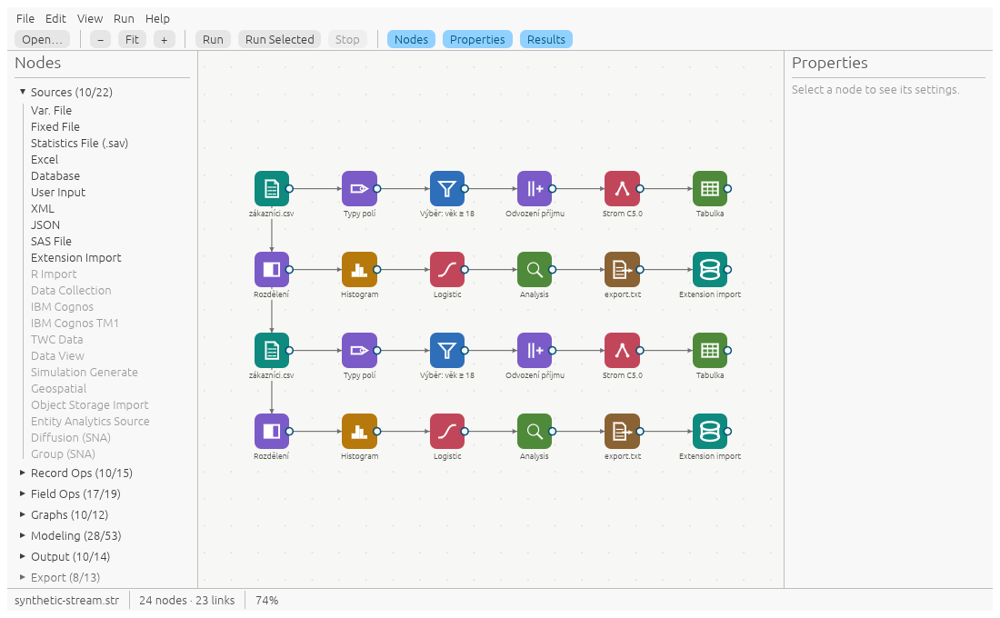

# Data Mining

[](LICENSE)

%20%7C%20Windows%20x64-blue.svg)


Source code, regression suite and verification records of **Data Mining**, a data-mining workbench written in Rust
that targets the single-machine feature set of IBM SPSS Modeler 19. It opens existing Modeler `.str` streams, runs
them, and saves streams in its own reviewable text format (`.dms`). Every number in this README is produced by a
command in this repository (`cargo xtask regress`, `parity`, `perf`, `ci`) and carries the date it was measured.

> **Free for individuals and educational institutions; no commercial use.** The code is released under the
> [PolyForm Noncommercial License 1.0.0](LICENSE) (see [License](#license)). It is not affiliated with, endorsed by
> or derived from IBM. "IBM", "SPSS" and "Modeler" are trademarks of their owners and are used here only to
> describe compatibility.

## Quick start

There is no pre-built download yet: you build the app from source. It takes a few commands and no configuration.

**macOS** (Apple silicon, macOS 11 or later)

```sh
xcode-select --install          # compiler and linker; skip if already installed
brew install unixodbc           # a library the app links (needs Homebrew, https://brew.sh)
curl --proto '=https' --tlsv1.2 -sSf https://sh.rustup.rs | sh     # Rust; the right version is picked automatically
git clone https://github.com/witold-andelie/data-mining-software.git
cd data-mining-software
cargo run -p dms --release      # builds and starts the app
```

**Windows** (x64)

1. Install Rust from <https://rustup.rs>. It needs the Microsoft C++ Build Tools; the installer tells you if they are
   missing and offers to install them. Install [Git](https://git-scm.com) if you do not have it.
2. In a terminal:

   ```powershell
   git clone https://github.com/witold-andelie/data-mining-software.git
   cd data-mining-software
   cargo run -p dms --release      # builds and starts the app
   ```

The first build compiles all dependencies: it took about 7 minutes on the Windows laptop this was checked on, with
two build jobs (the default uses every core and is faster). Later starts take seconds. The right Rust version (1.95.0) is
selected by `rust-toolchain.toml` and installed by `rustup` on the first command.

**Then:**

- **Open a stream:** File > Open… (a Modeler `.str` or our `.dms`), or pass it on the command line:
  `cargo run -p dms --release -- path/to/stream.str`. No stream at hand? `cargo run -p dms --release -- --synthetic 24`
  opens a generated one that needs no data files.
- **Run it:** press ⌘R (Ctrl+R on Windows). If the stream names data files saved on another machine, add the folder that
  holds them with File > Add Data Folder… (the app searches by file name).
- **A double-clickable app (macOS):** `cargo xtask bundle-mac` writes `target/dist/Data Mining.app` and a `.dmg`; drag the
  app to Applications and, the first time, right-click it in Finder and choose **Open** (it is signed ad hoc, not
  notarized).
- **Python nodes (optional):** `python3 -m pip install pyarrow pandas`, plus the libraries of the nodes you use (see
  [Python nodes](#python-nodes)).
- **Without a window:** `cargo run -p dms-cli -- run stream.str --out results/` (see [Command-line tool](#command-line-tool)).

More detail, requirements and options: [Installation in detail](#installation-in-detail).

## Overview

Modeler is the tool the team's analysis streams were built in. We needed those streams to open, run and be edited
without it, on Windows and on Apple-silicon Macs, where Modeler's own support is poor. The project is therefore a
**clean-room reimplementation checked as a black box**: Modeler is never inspected, only used to produce the expected
answer for each stream, and our result must agree with it record by record.

- **Opens Modeler streams.** Decodes `.str` files (a ZIP container holding Fast Infoset XML) without Modeler
  installed. Nodes and settings the application does not understand are kept exactly as saved and drawn with a dashed
  outline, so nothing is lost.
- **Runs them with verified results.** Each stream in a regression suite is run and every terminal node's input is
  compared with Modeler's own batch export (see [Key results](#key-results)).
- **All 85 MVP nodes**, across the standard palettes (Sources, Record Ops, Field Ops, Graphs, Modeling, Output,
  Export), plus 20 of 24 "later" nodes, including the complete Python palette.
- **Our own training algorithms.** C5.0, CHAID, C&R Tree, QUEST, linear and logistic regression, neural networks,
  K-Means, TwoStep, Apriori, time series and more, implemented from published documentation.
- **A visual editor and results viewer** (egui, no WebView): palette, canvas, generated settings forms, undo/redo,
  autosave and crash recovery; virtual-scrolling tables, statistics documents, model summaries and charts.
- **A Python bridge** for Extension nodes and Python modelling nodes, run in the user's own Python.
- **English and Simplified Chinese** interface, following the system language.

<p align="center"></p>
<p align="center"><em>The main window on a generated stream (the screenshot test's reference image: no IBM or team data). On macOS the menu is the native menu bar.</em></p>

## Main contributions

1. **A black-box verified clean room.** Every algorithm follows IBM's published *Algorithms Guide*, the user
   manuals, the scripting guide, the CLEM reference, the PMML standard and the open literature; Modeler's programs
   are never decompiled or opened, and no GPL code is read. Where the documentation is silent, behaviour is pinned
   down by differential probes (change one input, observe the output) and recorded under `docs/formats/`. See
   [Clean room](#clean-room).
2. **A regression suite against Modeler itself.** Streams, models and Modeler's expected outputs are pinned by
   SHA-256 and compared cell by cell on every platform.
3. **Two explicit parity levels.** Models whose training Modeler makes unreproducible (undocumented random number
   generator or optimizer stopping rule) are accepted at *statistical* parity under a stated method; everything else
   must match *exactly*. Nothing statistical is presented as exact.
4. **An editable, diff-friendly stream model.** Reversible edits drive undo/redo; the `.dms` format is TOML text that
   can be reviewed in git; imported settings are kept byte for byte unless the user changes them.
5. **One engine, many front ends.** Every user-visible action is a command with an id, so menus, shortcuts, the
   canvas, the command line and automation call the same code.
6. **Never crash.** Corrupt files, bad arguments and full disks produce errors you can act on, not crashes or lost
   work, enforced by lints and tests rather than by convention.

## Key results

| Question | Finding | Where |
|---|---|---|
| Does it read Modeler's streams? | Every `.str` in the corpus decodes; unknown nodes and settings are preserved and shown dashed. | `crates/strfmt` |
| Do results match Modeler? | A regression suite of **1,597 streams** is compared with Modeler's own batch output: **1,465 match exactly, 91 match to statistical parity, 41 are documented known gaps and 0 regress** (Windows, 2026-11-18, version 0.5.0). | `xtask/corpus.tsv`, `xtask/known-gaps.tsv` |
| Which models are exact? | C5.0, CHAID, C&R Tree and QUEST (without an overfit-prevention set), Tree-AS, Linear, Linear-AS, Regression, Logistic, Decision List, K-Means, TwoStep, Apriori, CARMA, PCA/Factor, Anomaly, Feature Selection, RBF. | `docs/statistical-parity.md` |
| Which are statistical? | MLP neural network, Kohonen, LSVM, Random Trees, Time Series, Sequence, Auto Cluster, Auto Classifier, Auto Numeric, and C&R Tree / QUEST with an overfit-prevention set: our result is compared with the spread of repeated runs of our own seedable implementation. | `docs/statistical-parity.md` |
| Same answers on Windows and macOS? | Yes. On 2026-11-09 the full regression on an Apple M1 classified all 1,596 streams that both machines had exactly as on Windows, with no floating-point differences beyond the comparison tolerance (printed precision, or relative 1e-9); the merged version 0.5.0 classifies all 1,597 streams on Windows exactly as the 2026-11-09 baseline did. | `docs/mac/windows-baseline.tsv`, `docs/mac/compare_baseline.py` |
| Time-series Expert Modeler? | 92 of 93 recorded ARIMA Expert selections and 26 of 26 univariate selections are reproduced; estimation follows the Guide's Marquardt procedure and matches Modeler to 11–14 digits for single-term ARMA and airline models. Mixed ARMA starting values are open (estimates agree to 2–4 digits). | [Known gaps](#known-gaps-and-their-impact) |
| Does Bayes Net work, if Modeler cannot run it? | Yes, from the public algorithm (TAN and Markov blanket). Two demo streams embed Bayes Net models Modeler trained earlier, so the learner is checked against them: it reproduces their structure and every probability table (to 1e-12) for TAN on two data sets and Markov blanket on one. That check found four places where the Guide's text alone gave a different network; they are fixed and listed in the module. Scores written by the nugget have no Modeler run to compare with. | `crates/algo/src/bayes_net.rs`, `crates/algo/tests/bayes_net_oracle.rs` |
| Do Cox and Generalized Linear work, if Modeler cannot run them? | Yes, from the public algorithms. Demo streams embed models Modeler trained, so the trainers are checked against them: Cox reproduces 12 coefficients (to 4e-15) and the 64-point baseline hazard (to 4e-11), and its stepwise selection picks exactly the saved terms; Generalized Linear reproduces the coefficients and covariance of three saved models (binomial with a complementary log-log link, and gamma with an inverse link and case weights; to 1e-15) and the goodness-of-fit and Type III tables Modeler printed. Scores written by the nuggets have no Modeler run to compare with. Cox strata and custom terms, Tweedie and multinomial targets are not implemented. | `crates/algo/src/cox.rs`, `crates/algo/src/genlin.rs`, `crates/exec/tests/cox.rs`, `crates/exec/tests/genlin.rs` |
| Do SVM and KNN work, if Modeler cannot run them? | Yes, from the public algorithms. SVM reproduces the two models saved in `svm_cancer`: the same support vectors for an RBF and a polynomial kernel, the polynomial model's coefficients, constant and Platt parameters to 1e-14 (the RBF model's coefficients agree to the solver tolerance), and every training record's class. KNN reproduces the neighbours and distances of every case in the model saved in `car_sales_knn` (462 distances to 4e-15). Scores the nuggets write have no Modeler run to compare with; KNN does not score a target or save neighbour details yet. | `crates/algo/src/svm.rs`, `crates/algo/src/knn.rs`, `crates/exec/tests/svm.rs`, `crates/algo/tests/knn_oracle.rs` |
| Is the editor fast enough? | On an Apple M1 (release build) a canvas with 200 labelled nodes pans at 60 fps with vertical sync and 176 fps without; 1,000 nodes 177 fps; first frame about 155 ms after launch. `cargo xtask perf` enforces a p95 frame budget of 4 ms. | `xtask/src/perf.rs` |
| What is not covered? | 41 documented known gaps and a handful of missing nodes and features, explained below. | [Known gaps](#known-gaps-and-their-impact) |

Node coverage, generated from the node catalog by `cargo xtask parity` (`docs/parity-checklist.md`):

| Scope | Implemented | Total | Notes |
|---|---|---|---|
| MVP | 85 | 85 | The standard single-machine palettes |
| Later | 21 | 24 | Python palette, extension nodes and Cox done; Streaming TS, GLMM and Temporal Causal Model remain |
| Licence-blocked | 4 | 6 | Standard nodes the oracle's Modeler licence greys out (SVM, KNN, Bayes Net, Discriminant, GenLin, SLRM), so they cannot be verified. SVM, KNN, Bayes Net and GenLin are implemented from the public algorithms and checked against models Modeler saved in demo streams; Discriminant and SLRM are not implemented |
| Out of scope | 0 | 34 | IBM ecosystem, big data, in-database mining, Statistics integration |

## Known gaps and their impact

A **gap** is a place where our result differs from Modeler's, or where a Modeler feature is missing. None is hidden:
`cargo xtask regress` lists every known gap with its reason in `xtask/known-gaps.tsv`, fails on a new difference, and
fails on a listed gap that has since been fixed, so the list cannot go stale.

**What it means in practice.** None of the gaps stops the core workflow (open, edit, run and save a stream): 1,556 of
1,597 recorded streams agree with Modeler exactly (1,465) or statistically (91). What you may notice:

1. A stream that uses a node we do not have runs up to that node and reports it; the rest of the stream is unaffected.
2. Models that depend on random numbers or on Modeler's optimizer stopping rule give **equivalent but not identical**
   numbers: do not expect the same weights, cluster layout or last digits.
3. Time-series models with both AR and MA terms give estimates that agree with Modeler to about 2–4 significant digits;
   a few badly conditioned fits differ more (see [Statistical parity](#2-statistical-parity-91-streams-not-failures)).
4. Nodes that sample without a seed (Balance) differ from run to run, in Modeler as well.

### 1. Documented known gaps: 41 of 1,597 streams

| Group | Streams | What differs | Impact |
|---|---|---|---|
| Nodes not implemented | 3 | Discriminant, CPLEX and Streaming Time Series. Discriminant is licence-blocked in Modeler 19, and CPLEX is out of scope | The node does not run. Its branch of a stream stops there; palette entries are greyed out with the reason. Cannot be verified against Modeler |
| SVM demo stream | 1 | `svm_cancer`: Modeler 19 cannot run the SVM nugget (licence), so the oracle's nuggets add no fields, while ours scores them from the models saved in the stream | The scores have no Modeler output to compare with; the build nodes are checked against the two saved models (see above) |
| Cox demo stream | 1 | `telco_coxreg`: the oracle's Modeler install has no Cox node, so its nuggets add no fields, while ours scores them from the model saved in the stream | The scores have no Modeler output to compare with; the build node is checked against the saved model (see above) |
| Bayes Net demo streams | 2 | `bayes_bankloan` and `bayes_churn_retrain`: Modeler 19 cannot run the Bayes Net nugget (licence), so the oracle's downstream filter carries no Bayes scores, while ours scores them from the models saved in the streams | The scores have no Modeler output to compare with; the learner itself is checked against the saved models (see above) |
| Demo streams with unsupported settings or an incomplete oracle | 3 | `modelingintro` (a Statistics File option, and Modeler's batch run finds nothing to execute), `stp_server_demo` (STP node; Modeler's own run fails), `pm_binaryclassifier` (the oracle retrains a replacement-linked Auto model, which is out of scope) | Affects those demo streams only |
| Time Series scoring of one demo | 1 | `broadband_create_models`: all four transfer-function targets match; for two series the first 63 rows differ because Modeler scores `Market_3` with its auxiliary Holt model instead of the saved primary ARIMA, and `Total`'s oracle model is not saved | Values in rows 1–63 of those two series differ; the other targets are exact |
| Unseeded Balance | 4 | The Balance node has no seed, so Modeler's own runs keep different records (row counts 1155 vs 1156, 356 vs 379, 206 vs 210, 7774 vs 7797) | No single Modeler run can be matched. Models trained downstream (for example the logistic regression) vary with the sample, as they do in Modeler |
| Excel test-fixture artifacts | 15 | Our generated test sheets contain cell-less `<row>` elements. Excel never writes them, and Modeler reads such sheets inconsistently, so we refuse them | None for files saved by Excel; 61 of 67 `sources` streams and 12 of 21 `excel_more` streams match |
| GLE: separated data and chaotic paths | 9 | Binomial identity/log fits where the data are separated, or where fitted means leave (0, 1) so the iteration is chaotic or Modeler's estimate is not a root of the score. `gle_binom_factor` is only a rounding difference of about 2e-7 relative | Affects ill-posed fits only: 40 of 49 GLE streams match exactly |
| Decision List | 1 | `dl05_carry`: a tie in the rule search picks a different first rule (equal total coverage, different partition) | One edge case; 11 of 12 Decision List streams match |
| Linear-AS | 1 | `x_shift`: forward selection treats one numerically degenerate term differently | Only when a candidate term is numerically degenerate; 20 of 21 Linear-AS streams match |

### 2. Statistical parity: 91 streams (not failures)

For these models Modeler's training cannot be reproduced bit for bit (an undocumented random number generator or
optimizer stopping rule), so the stream is accepted when Modeler's value lies inside the spread of our own seeded runs
(method in `docs/statistical-parity.md`). By model family: Time Series 33, Kohonen 17, MLP neural network 13, Sequence 12,
Random Trees 9, LSVM 3, QUEST 3, C&R Tree 1.

**Impact:** the models are equivalent in distribution but not numerically identical. Do not use them where a result must
match a Modeler run digit for digit. For the 33 Time Series streams, the first mismatching cell each one reports differs
from Modeler's by a median of 3e-6 (relative) and by less than 1e-4 in 29 of them. The other four are synthetic
no-constant ARMA fits on a series with a large mean, where the AR root is close to 1: the cell is a confidence limit and
the difference is 3e-4 to 0.38 (see below).

### 3. Open algorithm differences

- **Time-series estimation.** Modeler's optimizer follows the Guide's Marquardt procedure and we reproduce it to 11–14
  digits for single-term AR or MA models and for the airline model. For models with both AR and MA terms its starting
  values are not reproduced by any reading of the Guide we tried (about 20); the objective function is identical at
  Modeler's own saved estimates, so the difference is where the optimizer stops.
- **No-constant ARMA near a unit root.** On three synthetic probe streams (ARMA(1,1) without a constant, on a series
  whose mean is about 50) our estimate of the error variance differs from Modeler's by about 3 %, so the confidence
  limits differ much more than elsewhere (in the first row by tens of percent). The same fits with a constant match to
  about the usual 2–4 digits.
- **Time-series Expert Modeler.** One of 93 recorded ARIMA Expert selections differs (Modeler picks white noise where we
  keep an MA(2) at a partial-autocorrelation statistic of 2.2), and one of 23 transfer-function selections differs in
  its noise ARMA term.

### 4. Missing nodes and features

| Missing | Impact |
|---|---|
| Streaming TS, GLMM, Temporal Causal Model; graphics output and R syntax in Extension nodes | The nodes or options are absent |
| Licence-blocked (6) and out-of-scope (34) nodes | Listed in the catalog and greyed out in the palette, with the reason |
| Native models are not turned into nuggets after training in the app (C5.0, CHAID, ...), which needs a PMML writer | Train, then score by running the stream; nuggets imported in `.str` files score normally, and Python models do generate nuggets |
| Python Extension nodes from Modeler `.str` files | Kept, but usually do not run: how Modeler stores their settings has not been observed, and its Python extension API is Spark-based |
| TwoStep clustering on data whose CF tree needs a rebuild (more than three levels) | The node stops with a "not supported yet" error instead of producing a result. Seen on the team's `cluster_analysis` stream; the TwoStep streams in the corpus that fit the supported depth match |
| Supernodes | Shown and run, but cannot be edited |
| Settings forms cover the most-used nodes | Other nodes keep their imported settings and show them read-only |
| Python nodes have no Modeler oracle | Their score field names follow Modeler's naming but are inferred |

## Installation in detail

| | |
|---|---|
| macOS | Apple silicon (`aarch64-apple-darwin`), macOS 11 or later |
| Windows | x64 |
| Rust (to build) | 1.95.0, selected automatically by `rust-toolchain.toml` |
| Python (optional) | 3.9 or later with `pyarrow` and `pandas`, only for Python nodes |
| ODBC | The macOS app bundles the unixODBC driver manager (see [License](#license)). Building from source needs it installed (`brew install unixodbc`). Database nodes also need an ODBC driver for your database |

### The macOS app

1. Build the disk image: `cargo xtask bundle-mac` (needs the steps in [Quick start](#quick-start)).
2. Open the `.dmg` and drag **Data Mining** to Applications.
3. The app is signed ad hoc and not notarized: the first time, right-click it in Finder, choose
   **Open**, and confirm.
4. Double-clicking a `.str` or `.dms` file in Finder (or Open With) opens it in the app.
5. Optional: the command-line tool is inside the app; link it once with
   `sudo ln -sf "/Applications/Data Mining.app/Contents/MacOS/dms-cli" /usr/local/bin/dms-cli`.

`bundle-mac` builds the release binaries, copies the approved Homebrew ODBC libraries into the app (anything else
fails the build) and rewrites their references, adds the icon and licence files, signs ad hoc and creates the disk
image.

### Useful app options

| Option | Effect |
|---|---|
| `<file.str\|file.dms>` | Open this stream on start |
| `--run` | Run the opened stream, then quit without saving |
| `--data-dir <dir>` | Extra folder searched for data files the stream names (repeatable) |
| `--report <file>` | With `--run`: write a JSON run report |
| `--synthetic <n>` | Open a generated stream with `n` nodes (no data needed) |
| `--frame-time` | Show the CPU time of each frame in the status bar |

## Data

The raw data are not in the repository. `xtask/corpus.tsv` pins every corpus file by label, relative path and SHA-256
(**1,717 files in 83 labels**); the files themselves live in the git-ignored `corpus/` and
`oracle/` folders.

| Data | What it is | Handling | Used by |
|---|---|---|---|
| IBM sample streams and demo data | Streams and data shipped with Modeler 19 | Never committed; found through `DMS_MODELER_HOME` (`Demos/`) | `ibm-demos` label |
| Team streams | Seven analysis streams and their data | Never committed | `team` label |
| Probe streams | Streams and data our probe scripts generate from fixed seeds (`xtask/oracle/probes/`) | Recorded under `corpus/`, pinned by SHA-256 | all other labels |
| Oracle | Modeler's exported models (PMML) and each terminal node's input (CSV), recorded in batch mode with Modeler 19.0.0.0.26 on Windows | Under `oracle/<label>/<stream>/`; only `cargo xtask oracle` writes it | `regress`, `compare` |

The oracle is large (about 14 GB), almost all of it in `oracle/probes/` (9.3 GB) and `oracle/sources/excel_named_range`
(4.6 GB). **To run the regression on another machine** copy `corpus/` and the rest of `oracle/` (175 MB) and the
Modeler `Demos` folder, and set `DMS_MODELER_HOME` to the folder that contains it. `cargo xtask test-corpus` also needs
`oracle/probes/clem_semantics` and `oracle/probes/sav_to_csv` (4.5 MB).

Modeler is used only to produce expected answers; it is never linked, bundled or distributed. Recording oracles is
Windows-only and needs Modeler 19 and `DMS_MODELER_HOME`: `cargo xtask oracle <label> <file>.str` runs one corpus stream
in batch mode and writes each terminal node's input and each trained model, and `cargo xtask probe <name>` runs a
probe script (`xtask/oracle/probes/<name>.py`) to observe a file format or a node's behaviour.

## Using the desktop app

The window has a node **palette** on the left, the stream **canvas** in the middle, the **properties** panel on the
right and the **results** panel at the bottom; each can be hidden from the toolbar or the View menu.

**Building a stream.** Drag a node from the palette onto the canvas, or double-click it there (nodes not implemented
yet are greyed out, with the reason as a tooltip). Connect two nodes by dragging from the small circle on a node's right
edge, by holding Option (Alt on Windows) and dragging from the node, or by right-clicking and choosing **Connect From
Here**. Drag on empty canvas to box-select, hold Space and drag to pan, delete a connection by clicking it and pressing
Delete, and rename a node with Return (F2 on Windows).

**Editing settings.** Double-click a node to open its settings in a floating window with **Run** and **Close**; the
properties panel shows the same form. Forms are generated from each node's settings schema (checkboxes, ranges,
choices, field pickers filled from the last run, file pickers, CLEM expressions with syntax checking, tables, code
editors). Every change is one undo step. Nodes whose settings cannot be edited yet show them read-only.

**Running and results.** **Run** (⌘R) runs the whole stream, **Run Selected** (⇧⌘R) the selected node and what it
needs, in the background with a progress bar; **Stop** (⌘.) cancels, including long model training. The results panel
has one tab per terminal node: data tables, output documents (Statistics, Data Audit, Matrix, Means, Analysis, ...),
model summaries, and charts for graph nodes (Histogram, Distribution, Plot, Multiplot, Time Plot, Evaluation,
Collection, t-SNE). A failed node shows why, and nodes that did not run say which upstream node to look at. Streams
often name data files on the machine that saved them: the app looks in the stream's folder first, then in the folders
added with **File > Add Data Folder…**, by file name.

**Saving.** Streams are saved as `.dms` (⌘S, ⇧⌘S); imported `.str` files are never overwritten. Edits are autosaved
and unsaved streams are offered for recovery after a crash.

**Settings** (⌘,): language (System, English, 简体中文), data folders, and the Python executable with a **Check Python**
button.

| Action | macOS | Windows |
|---|---|---|
| New / Open / Close | ⌘N / ⌘O / ⌘W | Ctrl+N / Ctrl+O / Ctrl+W |
| Save / Save As | ⌘S / ⇧⌘S | Ctrl+S / Ctrl+Shift+S |
| Undo / Redo | ⌘Z / ⇧⌘Z | Ctrl+Z / Ctrl+Shift+Z |
| Cut / Copy / Paste / Duplicate | ⌘X / ⌘C / ⌘V / ⌘D | Ctrl+X / Ctrl+C / Ctrl+V / Ctrl+D |
| Run stream / Run selected / Stop | ⌘R / ⇧⌘R / ⌘. | Ctrl+R / Ctrl+Shift+R / Escape |
| Zoom in / out / to fit | ⌘= / ⌘- / ⌘0 | Ctrl+= / Ctrl+- / Ctrl+0 |
| Rename / Delete | ↩ / ⌫ | F2 / Delete |
| Full screen | ⌃⌘F | F11 |

On macOS the menu bar is the native one; on Windows the same menus are drawn in the window. Both are generated from
one command table.

## Python nodes

Python nodes run in **your own Python**, as a separate process: no Python is bundled and libpython is not linked. Data
goes to Python and back as Apache Arrow files in a private temporary folder; scripts see a pandas DataFrame.

```sh
python3 -m pip install pyarrow pandas            # every Python node
python3 -m pip install scikit-learn              # Random Forest, GMM, One-Class SVM, KDE, t-SNE
python3 -m pip install xgboost                   # XGBoost Tree / Linear
python3 -m pip install hdbscan                   # HDBSCAN
python3 -m pip install imbalanced-learn          # SMOTE
brew install libomp                              # macOS only: OpenMP runtime xgboost needs
```

The app looks for Python in this order: the path in Settings; `DMS_PYTHON`; on macOS `/opt/homebrew/bin/python3` and
`/usr/local/bin/python3` (apps opened from Finder get a short `PATH`); then `python3` and `python` (`py -3` first on
Windows). A configured path that does not work is reported, never silently replaced, and missing packages produce the
exact install command.

**Extension scripts** see `modelerData` (the input as a pandas DataFrame, `None` in Extension Import),
`modelerDataModel` (a list of `{name, storage, measurement, role}`) and `print(...)` (the Extension Output result).
Import and Transform scripts leave their result in `modelerData`; errors report the line of your script.

| Palette | Node | Library |
|---|---|---|
| Sources / Record Ops | Extension Import, Extension Transform | your script |
| Record Ops | SMOTE | imbalanced-learn |
| Graphs | t-SNE | scikit-learn |
| Modeling | Random Forest, Gaussian Mixture, One-Class SVM, KDE | scikit-learn |
| Modeling | XGBoost Tree, XGBoost Linear | xgboost |
| Modeling | HDBSCAN | hdbscan |
| Modeling | Extension Model | your build and score scripts |
| Output / Export | Extension Output, KDE Simulation, Extension Export | your script / scikit-learn |

As in Modeler, running a Python build node trains the model and places a **model nugget** next to it. The model is
stored inside the stream as a pickle attachment, so it survives saving and reopening. A continuous target is regressed,
any other is classified; with a partition field only the training partition is used.

> **Security.** Running a stream runs the Python code in it, and loading a saved Python model unpickles it, which can
> also run code, with your permissions. This is the same trust model as Modeler: only run streams you trust.

## Command-line tool

`dms-cli` works without the window (on macOS it ships inside the app; from source use `cargo run -p dms-cli -- <command>`):

```text
dms-cli xml <file.str>                 print the decoded stream document as XML
dms-cli inspect <file.str>             print nodes, links and attachments as JSON
dms-cli coverage [--json] <path>...    report which catalog nodes the .str files use
dms-cli convert <in.str> <out.dms>     import a stream and save it in the native format
dms-cli run <file.str|file.dms> --out <dir> [--data-dir <dir>]... [--terminal-order <uid,...>]
                                       run the stream; write the data reaching each terminal
                                       node to <dir>/<uid>.csv and a report to <dir>/run.json
```

Export nodes write under `<dir>/exports/`, never over the paths saved in the stream.

## File formats

| Format | Read | Write | Notes |
|---|---|---|---|
| Modeler stream `.str` | ✓ | — | ZIP + Fast Infoset (ITU-T X.891); unknown nodes and settings preserved; node settings as observed in `docs/formats/` |
| Native stream `.dms` | ✓ | ✓ | TOML text; attachments (models, extension settings) as base64; saved atomically |
| Delimited text, fixed-width | ✓ | ✓ | Var. File, Fixed File, Flat File export |
| SPSS Statistics `.sav` / `.zsav` | ✓ | ✓ | Our own reader and writer |
| Excel `.xlsx`, SAS, JSON, XML | ✓ | ✓ | |
| Databases (ODBC) | ✓ | ✓ | Needs an ODBC driver manager |
| PMML 4.3 | ✓ | — | Model nuggets in `.str` files score from their saved PMML |

## Reproducing the verification

Run these from the repository root. The regression and corpus checks need `corpus/` and `oracle/` in place (see
[Data](#data)); the others need nothing.

| Check | Command | Needs | Measured time |
|---|---|---|---|
| All build gates | `cargo xtask ci` | nothing | about 2.5 min on an M1 (warm build) |
| Corpus integrity | `cargo xtask corpus verify` | `corpus/` | seconds |
| Corpus-backed tests | `cargo xtask test-corpus` | `corpus/`, `oracle/probes/` | about 2 min (M1) |
| Full regression | the command below | `corpus/`, `oracle/` (without `probes/`, `excel_named_range`) | about 7 min (M1, `--jobs 4`) |
| One stream against its oracle | `cargo xtask compare <label> <file>.str` (file name only) | `corpus/`, `oracle/` | seconds |
| Compare two platforms | `python3 docs/mac/compare_baseline.py docs/mac/windows-baseline.tsv <mac.tsv>` | two regress `--out` files | seconds |
| Canvas frame budget | `cargo xtask perf` | nothing | seconds |

```sh
labels=$(awk -F'\t' 'NR>1 && $1!~/^#/ {print $1}' xtask/corpus.tsv | sort -u \
  | grep -vx -e database -e probes | sed 's/^/--label /' | tr '\n' ' ')
cargo xtask regress $labels --jobs 4 --out target/regress.tsv
```

Do not run `regress` without labels, or with the `database` label, on a machine with the Access ODBC driver: it opens
a modal dialog and hangs. Do not edit source files while a regression runs; later streams fail to build and show up as
false regressions.

## Verification

- **Oracle comparison.** For every stream with an oracle, each terminal node's input is compared with Modeler's export
  cell by cell: numbers within printed precision or relative 1e-9, text and missing values exactly. A stream is
  `match`, `statistical` (held to the statistical-parity method), `known-gap` (listed with a reason in
  `xtask/known-gaps.tsv`) or `regression`. The command fails on a regression and on a known-gap entry that now matches,
  so fixed gaps are deleted instead of lingering.
- **A change is adopted only if more oracle streams match and none regress.** Hypotheses that fit some cases and break
  others are measured, reported and not shipped.
- **Statistical parity** is tested by training with at least 10 seeds of our own generator: Modeler's value must lie
  inside our seeds' range widened by 10 % of its width, and must also rank near the middle of our distribution across
  the oracle family, so a wide band cannot hide a systematic bias. Documented outliers are asserted to stay outliers
  (`docs/statistical-parity.md`).
- **Platform parity.** The same regression runs on Windows and on Apple silicon and is compared stream by stream
  (`docs/mac/`).
- **Interface tests.** Off-screen screenshot tests (egui_kittest on wgpu) render synthetic streams only, and
  interaction tests send real pointer and keyboard events (connecting, menus, editing, undo, settings, translations).
  Reference images are updated only after review.
- **Never crash.** Non-test code may not use `unwrap`, `expect`, `panic!`, `unreachable!`, `todo!` or
  `unimplemented!` (workspace lints), and `unsafe` is forbidden outside `dms-macos-open`. Numbers from files and
  arguments are treated as hostile; every crash fix comes with a test that panicked before the fix, and parsers have
  mutation fuzz tests.
- **Agent-assisted work is checked, not trusted.** Parts of the code were written with AI coding agents. Each result is
  merged only after the coordinator reruns `cargo xtask ci` and the regression itself.

## Limitations

- **One reference version.** The expected answers come from Modeler 19.0.0.0.26, recorded on one Windows machine and
  its licence tier. Behaviour of other versions, and of nodes that licence blocks, is not checked.
- **Comparison at terminal nodes.** Results are compared where a stream ends (each terminal node's input) and for saved
  models, not at every intermediate node.
- **Windows** builds, passes `cargo xtask ci` and the full regression, but the desktop app has not yet had a full manual
  pass there.
- The gaps, missing nodes and their effects are listed under [Known gaps and their impact](#known-gaps-and-their-impact).

## Repository structure

```
apps/
  dms/              desktop application (eframe; native menus and bundle metadata on macOS)
  dms-cli/          command-line tool
crates/
  types/ strfmt/ sav/ pmml/      L0  values and tables; .str container; .sav; PMML 4.3
  stream/ clem/                  L1  stream model, reversible edits, .dms; CLEM expressions
  catalog/ io/ algo/ python/     L2  node catalog; data files and databases; training algorithms; Python bridge
  exec/                          L3  executor, settings schemas, cancellation
  engine/                        L4  session, command registry, undo/redo, background jobs, autosave
  ui/ macos-open/                L6  egui canvas, panels, forms, results, charts; Finder file opening
docs/
  statistical-parity.md          how statistical parity is tested
  parity-checklist.md            every Modeler node and its status (generated by cargo xtask parity)
  decision-list-validation.md    Decision List validation notes
  node-implementation.md         how a node is implemented
  clem/                          CLEM reference and the behaviour the oracle showed
  formats/                       node-settings findings, as observed
  mac/                           macOS regression baselines and the comparison script
xtask/              developer tasks (ci, layers, parity, corpus, oracle, regress, compare, perf, bundle-mac)
                    corpus.tsv, known-gaps.tsv, oracle scripts and probes, scorecard
corpus/, oracle/    local only, git-ignored
```

A crate may depend only on crates in lower layers, and nothing below the UI layer may use a GUI library;
`cargo xtask layers` enforces both. Design principles:

- **Everything is a command.** Menus, shortcuts, the canvas, the command line and automation call engine commands by id
  (`file.save`, `node.connect`, `run.node`, ...); commands never open dialogs themselves.
- **Data types are runtime data.** Storage, measurement level, role, missing values and date baselines are never
  hard-coded.
- **Settings are kept verbatim** unless the user changes them; forms read and write them through per-node schemas.
- **Long work is cancellable.** Execution and training check a shared cancel token; Python processes are killed on Stop.

## Development

Rust 1.95.0 (`rust-toolchain.toml`), edition 2024. New dependencies must be permissively licensed (MIT, Apache-2.0,
BSD, ISC, Zlib, BSL-1.0, Unicode-3.0, CC0; MPL-2.0 only for test-only dependencies) and pinned in the workspace
`Cargo.toml`.

```sh
cargo xtask ci                 # fmt, clippy -D warnings, all tests, layers, parity: run before every commit
cargo xtask layers             # check the dependency layers
cargo xtask parity [--check]   # regenerate docs/parity-checklist.md from the catalog
cargo xtask corpus sync <label> <dir>
cargo xtask regress [--label <label>]... [--jobs <n>] [--via-dms] [--out <file>]
cargo xtask oracle <label> <path>   # Windows + Modeler only: record expected answers
cargo xtask probe <name>            # Windows + Modeler only: differential format probe
```

Commits follow Conventional Commits (`feat(exec): ...`, `fix(ui): ...`). Errors carry context and say what the user can
do.

## Clean room

Every modelling algorithm in this project is implemented and trained by us. None of it is reverse-engineered from IBM
SPSS Modeler, and no Modeler code is reused.

- **We never look inside Modeler.** Its jars, DLLs and executables are never decompiled, disassembled or opened. C5.0 is
  RuleQuest's proprietary algorithm; the C5.0/See5 source has not been consulted either.
- **Only public sources:** IBM's published *Algorithms Guide* (formulas), the user manuals, the *Python Scripting and
  Automation Guide* (node properties), the CLEM reference, the PMML standard (DMG) and the open literature. Each
  algorithm module cites the chapter and page it implements.
- **Modeler is only a black-box oracle.** We prepare input data, let Modeler train and score in batch mode, and compare
  its output with ours cell by cell. The `.str` format is learned the same way: save a stream twice with one setting
  changed and compare the bytes.
- **No GPL code.** GPL/LGPL/AGPL code (for example PSPP) is never read or copied.
- **No IBM assets.** No IBM icons, wording or colours are used; IBM sample streams, team data and Modeler outputs stay
  in the git-ignored `corpus/` and `oracle/` folders and are never committed or distributed.

## Citation

If you use the software in research or teaching, please cite it as:

```bibtex
@misc{ma2026datamining,
  author = {Ma, Wentao},
  title  = {Data Mining: a {Rust} workbench for {SPSS} {Modeler} 19 streams},
  note   = {Software, version 0.5.0; code at https://github.com/witold-andelie/data-mining-software},
  year   = {2026}
}
```

## License

The code is released under the **[PolyForm Noncommercial License 1.0.0](LICENSE)** (SPDX identifier
`PolyForm-Noncommercial-1.0.0`). In short:

- **Free to use, study, modify and share** for any noncommercial purpose. That explicitly includes personal use
  (research, experiments, study, hobby projects without an anticipated commercial application) and use by
  educational institutions, public research organizations, charities, public safety or health organizations,
  environmental protection organizations and government institutions, regardless of how the work is funded.
- **Not allowed without a separate licence:** commercial use, for example building it into a company's products or
  services, or using it for paid work for clients.
- If you share the software or a changed version, you must pass on the licence text (or its URL) and the line
  beginning `Required Notice:` in the [`LICENSE`](LICENSE) file.
- **Commercial licences** are granted by the author on request; contact the repository owner on GitHub.

This is a source-available licence, not one approved by the Open Source Initiative, so the project is not "open
source" in that sense. The summary above is for convenience; the licence text governs. Third-party dependencies keep
their own permissive licences (list them with `cargo metadata`).

**Bundled ODBC libraries.** The macOS app ships two LGPL libraries as an approved exception to the permissive-only rule:
`libodbc` from unixODBC (LGPL-2.1-or-later) and `libltdl` from GNU libtool (LGPL-2.0-or-later), which `libodbc` needs.
They are unmodified, dynamically linked and kept as separate files in `Contents/Frameworks`, so they can be replaced.
Their licence texts and source locations are in `Contents/Resources/Licenses/` inside the app.

## Acknowledgements

The author thanks [IBM](https://github.com/IBM) for publishing the documentation this work follows (the SPSS Modeler
*Algorithms Guide*, user manuals, scripting guide and CLEM reference). This does not imply any affiliation with, or
endorsement by, IBM.

The author also thanks the [REA](https://github.com/morluto/rea) project (*Reverse Engineer Anything*, by morluto,
MIT licence).

The work rests on other public material: the Data Mining Group's PMML standard, ITU-T X.891 (Fast Infoset), the
Rust ecosystem, and the egui project and its libraries.
