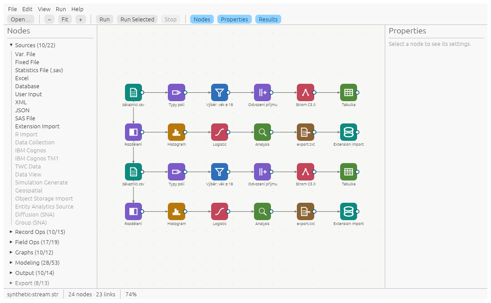

# About Data Mining

What the project is, what it contributes and how it stays clean-room. The front page is the [README](../README.md).

## Overview

Modeler is the tool the team's analysis streams were built in. We needed those streams to open, run and be edited
without it, on Windows and on Apple-silicon Macs, where Modeler's own support is poor. The project is therefore a
**clean-room reimplementation checked as a black box**: Modeler is never inspected, only used to produce the expected
answer for each stream, and our result must agree with it record by record.

- **Small and self-contained.** The macOS disk image is **19.4 MB** and the Windows download is **18.1 MB**
  (one **32.8 MB** executable, plus a 16.0 MB command-line tool), against **5.1 GB** for the Modeler 19 installation it replaces on the
  machine the oracles were recorded on (see [Key results](verification.md#key-results)). No Java runtime, no Spark, no database server and no Python are needed to open,
  edit and run streams; Python is only for the optional Python nodes.
- **Opens Modeler streams.** Decodes `.str` files (a ZIP container holding Fast Infoset XML) without Modeler
  installed. Nodes and settings the application does not understand are kept exactly as saved and drawn with a dashed
  outline, so nothing is lost.
- **Runs them with verified results.** Each stream in a regression suite is run and every terminal node's input is
  compared with Modeler's own batch export (see [Key results](verification.md#key-results)).
- **All 85 MVP nodes**, across the standard palettes (Sources, Record Ops, Field Ops, Graphs, Modeling, Output,
  Export), plus all 24 "later" nodes, including the complete Python palette, and the six standard nodes Modeler's
  licence tier greys out in the oracle's installation.
- **Our own training algorithms.** C5.0, CHAID, C&R Tree, QUEST, linear, logistic and generalized linear regression,
  Cox regression, discriminant analysis, neural networks, SVM, KNN, Bayes Net, K-Means, TwoStep, Apriori, time series
  and more, implemented from published documentation.
- **A visual editor and results viewer** (egui, no WebView): palette, canvas, generated settings forms, undo/redo,
  autosave and crash recovery; virtual-scrolling tables, statistics documents, model summaries and charts.
- **A Python bridge** for Extension nodes and Python modelling nodes, run in the user's own Python.
- **English and Simplified Chinese** interface, following the system language.

<em>The main window on a generated stream (the screenshot test's reference image: no IBM or team data). On macOS the menu is the native menu bar.</em>

## Main contributions

1. **A black-box verified clean room.** Every algorithm follows IBM's published *Algorithms Guide*, the user
   manuals, the scripting guide, the CLEM reference, the PMML standard and the open literature; Modeler's programs
   are never decompiled or opened, and no GPL code is read. Where the documentation is silent, behaviour is pinned
   down by differential probes (change one input, observe the output) and recorded under `docs/formats/`. See
   [Clean room](#clean-room).
2. **A regression suite against Modeler itself.** Streams, models and Modeler's expected outputs are pinned by
   SHA-256 and compared cell by cell on every platform.
3. **Two explicit parity levels.** Models whose training Modeler makes unreproducible (undocumented random number
   generator or optimizer stopping rule) are accepted at *statistical* parity under a stated method; everything else
   must match *exactly*. Nothing statistical is presented as exact.
4. **An editable, diff-friendly stream model.** Reversible edits drive undo/redo; the `.dms` format is TOML text that
   can be reviewed in git; imported settings are kept byte for byte unless the user changes them.
5. **One engine, many front ends.** Every user-visible action is a command with an id, so menus, shortcuts, the
   canvas, the command line and automation call the same code.
6. **Never crash.** Corrupt files, bad arguments and full disks produce errors you can act on, not crashes or lost
   work, enforced by lints and tests rather than by convention.

## Clean room

Every modelling algorithm in this project is implemented and trained by us. None of it is reverse-engineered from IBM
SPSS Modeler, and no Modeler code is reused.

- **We never look inside Modeler.** Its jars, DLLs and executables are never decompiled, disassembled or opened. C5.0 is
  RuleQuest's proprietary algorithm; the C5.0/See5 source has not been consulted either.
- **Only public sources:** IBM's published *Algorithms Guide* (formulas), the user manuals, the *Python Scripting and
  Automation Guide* (node properties), the CLEM reference, the PMML standard (DMG) and the open literature. Each
  algorithm module cites the chapter and page it implements.
- **Modeler is only a black-box oracle.** We prepare input data, let Modeler train and score in batch mode, and compare
  its output with ours cell by cell. The `.str` format is learned the same way: save a stream twice with one setting
  changed and compare the bytes.
- **No GPL code.** GPL/LGPL/AGPL code (for example PSPP) is never read or copied.
- **No IBM assets.** No IBM icons, wording or colours are used; IBM sample streams, team data and Modeler outputs stay
  in the git-ignored `corpus/` and `oracle/` folders and are never committed or distributed.
